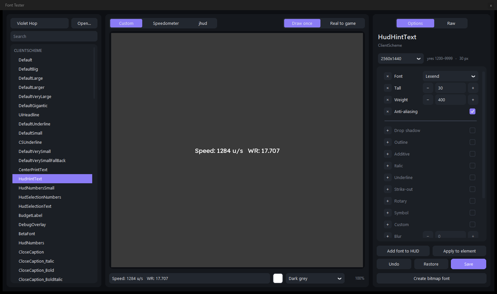

# CS:S Font Tester

Shows a HUD's fonts the way Counter-Strike: Source draws them, without the game, and edits the HUD's font blocks.
It redraws by itself when the HUD's scheme or font files change (unless they have changes here not saved yet).



Windows only: it draws with Windows' own font calls, as the game does. The current version is **1.0**: download
`FontTester.exe` from the [1.0 release](https://github.com/teleqwe/css-font-tester/releases/tag/v1.0.0) and double-click
it, or run it from source (below). The exe isn't signed, so Windows SmartScreen or an antivirus may warn
about it the first time.

It finds Counter-Strike: Source through Steam (any of its library folders) and opens the HUD in its `custom` folder
(the one opened last, if there are several; **Open…** picks any other HUD folder).
For HUDs that `#base` a scheme file they don't have, it reads the game's own one the way the game looks for it: from
`cstrike_pak_dir.vpk`, then the `cstrike`, `hl2` and `platform` folders. Without CS:S installed it still works: open a
HUD with **Open…** (fonts the HUD leaves to the game's own schemes are then missing, and so are the map texture
backgrounds).

## Running from source and building
Python 3.12 or newer (64-bit, with tkinter) and the packages in `requirements.txt` (`pip install -r requirements.txt`),
then `pythonw fonttester.pyw` (`python fonttester.pyw` shows any error if nothing appears). To build the exe:
```
powershell -ExecutionPolicy Bypass -File build.ps1
```
Runs the checks (`python cssfont.py`, then `python test_fonttester.py`, which runs hidden on a copy of the small HUD in
`tests/hud`; neither needs CS:S), builds `FontTester.exe` with PyInstaller and runs the exe's own check
(`FontTester.exe --selftest out.txt` writes `ok`). `-Desktop` also copies it to the desktop and checks that copy.

## Using it
- **Left**: the HUD (found in the game's `custom` folder; **Open…** for another) and every font of its ClientScheme,
  SourceScheme and ChatScheme (with their `#base` files; the fonts in `CustomFontFiles` loaded for this program).
  Ctrl+click shows several; the HUD and the fonts picked last are picked again at the next start (none the first
  time); right-click: favourites, kept at the top between runs
  (`%APPDATA%\CSS Font Tester\settings.json`).
- **Middle**: the text as the game draws it, in the middle of a screen of the size picked on the right. Scroll to zoom
  around the pointer (25% to 1600%, hard pixels), drag to move, double-click to go back. **Custom**: the text typed
  below, in the picked fonts. **Speedometer**: a four-digit speed changing every _n_ ms (1-1000), white when it rises,
  cyan when level, red when it falls (bhop-get-stats' colours). **jhud**: "jump: speed (sync%)" over the gain, each
  line centred, a font's height apart, coloured by speed (jumps 1-6) or gain, every _n_ ms. Behind: a colour, a map
  texture (read from the game's `cstrike_pak_dir.vpk` when picked) or a screenshot.
- **Draw once / Real to game**: the servers' HudMsg texts (CenterPrintText: jhud, shavit's top-left records) are drawn
  once for every send the game still holds, over each other, which takes the smoothing off their edges. Real to game
  does that as the plugins send (read 2026-10-11): bhop-get-stats' speedometer every 10 ticks held 0.2 s (2 copies at
  100 ms), its jhud each jump held 1.0 s (2 copies for a while after each jump), shavit-hud's records every 100 ticks
  held 2.6 s (2-3 copies; Custom). Other fonts (centre print, hint box) are drawn once either way.
- **Right**: the picked font's block for this screen: Font, Tall, Weight, every flag, Blur, Scan lines, Bitmap, Scale
  (− and + step numbers by 1, weight by 100). Ticking a box puts its line in the block and unticking takes it out; a
  number set to the game's default (blur 0, scale 1...) takes its line out too. When a font is picked, the options its
  block has come first, in its order (drag a row by anything but its fields to move its line), then under a line the
  rest, greyed. Hover an option's name for what it does in the game (from in-game shots). Under the name, the yres the entry
  gets and its size. **Raw** (top right) shows instead, from the name down to the buttons, the font's block as the
  file has it, from the line with its name to the line before the next font's (the app's copy: changes not saved yet
  show too).
  - Every change goes into the app's copy of the scheme by itself, a moment after it's made, as this screen's
    entry: the first change to a font with an entry per screen size makes it a new entry from just above
    the last yres range that ends below this screen up to 9999 (an element with "1" at 1-1080 gets "1081+" at
    1081-9999), put before the entry used now, so it's the one used from there up. CenterPrintText, one entry the game
    grows with the screen, is changed in place instead (no yres; a bitmap font gets 1-9999 so it isn't grown), its
    unticked flags written as 0 so the `#base` file's don't come back. A font that grew (an entry without yres) shows
    its sizes in px here, the size it's drawn now.
  - **Add font to HUD** copies the face's font file (as Windows draws it at that weight: a real bold if the PC has
    one) into the HUD's `resource/fonts` and lists it in `CustomFontFiles`. Mind the font's licence before sharing a HUD
    with it: Windows' own fonts (Arial and the like) may not be passed on.
  - **Save** writes the changed scheme files (• on it while there are changes); if one changed on disk since, it asks
    first. Closing the app or opening another HUD with changes not saved asks too. **Undo** takes back the last change
    (an edit, Add font to HUD, a made bitmap font and the files it made, if not saved yet); **Restore** puts the font blocks back as
    they were when the app opened (then Save; font files it added stay).
  - **Create bitmap font**: a font made from every setting a picture of letters can hold: face, size, weight,
    anti-aliasing, italic, underline, strike-out, the game's drop shadow and outline at any size (not just 1 px), a
    smooth outline (round, grown from the letter's half-covered edge so it's as wide on every side, in half px too;
    it covers the faint edge pixels the game's outline leaves), letter spacing, even gaps (every letter's ink, outline
    included, the spacing apart; digits one shared width or each their own), brackets centred on the digits, edge
    sharpness (a narrower soft edge, so a server text drawn twice over itself pulses less; 100: none at all), blur, scan lines, rotary line, the
    colour and opacity of the letters, of the outline and shadow, and a box behind the text (each letter's cell its
    whole advance wide, so they meet into one box; a space is a gap in it). Make
    saves `<name>.vbf` + `.vtf` in the HUD's `materials/vgui/fonts`, lists it in `BitmapFontFiles` and switches the
    font to it; Save, restart the game (it reads `BitmapFontFiles` at start). The game multiplies
    a bitmap font by the text colour, so colours made into it show as made under white text.

## How it matches the game
`cssfont.py` does what the game's vgui code does (read from the CS:S source and the shipped DLLs; no game code is
copied):
- each letter from `CreateFontA` (tall, weight, ANSI charset, anti-aliased or not) and `GetGlyphOutlineA`
  (`GGO_GRAY8_BITMAP`, alpha = level x 255 / 64), or `ExtTextOutW` white on black when not anti-aliased;
- the cell: ABC width b plus the effects' margins, the font's height (+1 for a drop shadow, +2 for an outline);
- effects in the game's order and with its quirks: drop shadow (black into clear pixels, the alpha of the pixel
  up-left), outline (solid black on clear pixels next to any lit pixel, faint ones too), blur (alpha only, turns the
  letter white), scan lines (every row x 0.7 except each n-th), rotary (a grey middle line);
- the line: each letter at pen + a, pen + a + b + c, every character drawn, spaces too (a blank cell that still takes
  the rotary line and an underline); an underlined letter's cell is a + b + c wide and goes at the pen (a smoothed
  one a further a to the left);
- blending in linear light: colours read as gamma 2.2, the result written with the sRGB curve (text colour 255 170 60
  shows as 255 171 57 in game), additive fonts added;
- each letter's cell 2 px wider than its ABC width b and 2 px taller than the font, spacing unchanged: a glyph one
  pixel past b shows, blur spreads into the room, the rotary line runs on through it (row height / 2 + 1);
- characters past 0xFF (Ā, Ж) drawn by Tahoma at the same size and effects, for every face but Marlett and Tahoma
  (vguimatsurface's SetFontGlyphSet), its cell point-sampled to the font's own height;
- schemes: `#base` files fill in what the file lacks, `[$WIN32]`-style conditions, the first entry whose `yres`
  fits (`range` changes nothing: with several entries every letter comes from the first, checked in game), proportional entries without `yres` scaled by height / 480, `tall` capped at 255, missing faces falling back
  (Verdana and Trebuchet MS to Arial, everything else to Tahoma), and a proportional font whose tall grew gets
  anti-aliasing turned on (vgui2.dll, read 2026-10-10);
- bitmap fonts (vguimatsurface.dll's CBitmapFont, read 2026-10-10): the `.vbf` from the HUD (else `cstrike`), its page
  the texture `materials/vgui/fonts/<the .vbf's name, lower-case>.vtf`; ABC widths, height and ascent times
  scalex/scaley, truncated (each of a, b and c on its own, measured in game at x2.25); each letter's rectangle stretched to its
  width + 2 by the height + 2 (measured in game 2026-10-17: the same 2 px of room as a Windows font's letters, but
  stretched into), point sampled if the texture says so, else bilinear the card's way (each channel on its own, colour in linear light,
  the page's own pixels round the rectangle), times the colour. Create bitmap font leaves those 2 px empty
  in each letter's rectangle, so the game draws its letters unstretched. Of the entry's flags only additive
  counts. A proportional entry without `yres` grows its scales by screen height / 480 (on scale x 10000, truncated).
  VTFs read: the usual 8-bit formats and DXT1/3/5.

Checked against the game (2026-10-12, lossless in-game screenshots, 2560x1440: Arial 40 px fixed and 42 px
grown, colour 255 170 60 on grey 90 and 225, every flag alone and in pairs, with and without anti-aliasing; "AgQ5 éĀЖ"
in Arial, Segoe UI 300-900, Impact, Verdana, Tahoma, a missing face, Marlett and Wingdings with and without Symbol;
sizes 100-300): every one under 1 level of 255 on average (most 0.0-0.3) and 1-2 off on almost every pixel, blur,
rotary and underline included. Server texts (HudMsg, Trebuchet MS 18 grown, sent at the plugins' timings, 78 shots over grey 90 and
226): drawn with the copies the game held (1 for single sends, 2 for the speedometer, 2-3 for the records), every look
(additive, plain, no anti-aliasing, outline, drop shadow, scan lines) within 0.2-0.7 levels on average; with blur 2.2.

Bitmap fonts checked against the game (2026-10-17, lossless shots at 2560x1440 and 1920x1080: Lexend bitmap fonts at
18, 36 and 100 px, scalex/scaley 2, one grown with the screen (x3 and x2.25) and one additive, beside the same face as
a Windows font): every line within 0.1 levels of 255 on average and 1 at most. The same 36 px bitmap with outline, drop shadow,
blur, scan lines, italic, underline, strike-out, rotary, symbol, custom, anti-aliasing 0 or another tall in its block
drew identically (0.03 levels): the game ignores all of them for bitmap fonts, as the tester does. A texture without
point sampling, scaled x1.5, x2 and grown x3, matched within 0.2 levels on average, 2 at most.

Checked against the game (2026-10-09, a HUD at 2560x1440 on a test server): the record times line
(CenterPrintText, Lexend 700, 54 px, drop shadow) came out the same size to the pixel, 377 x 30, and drawn 5 times
its pixels differ from the game's by 2 levels of 255 on average (13 if drawn once; 0.8 on the letters' edges alone).
The small speed (SourceScheme's Trebuchet24) used its `1081 1440` entry at 1440, so SourceScheme fonts go by the real
screen height too.

## Not done
- other languages' minimum heights; the game anti-aliases only Latin-1 letters unless the font
  has `"custom" "1"`, and so does this.
- Whether a HUD panel asks for its font proportional: assumed yes (the HUD's are).

`python cssfont.py` runs its self-check.

## Licence
MIT, see `LICENSE`. Counter-Strike: Source and its files belong to Valve; nothing of the game's is included here.
